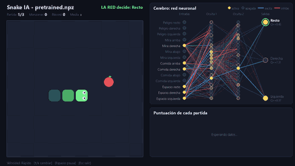
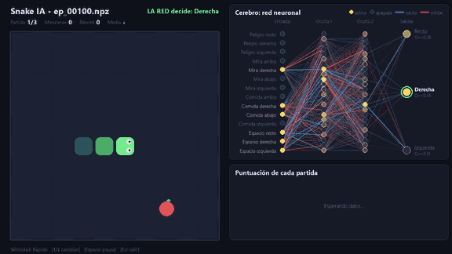
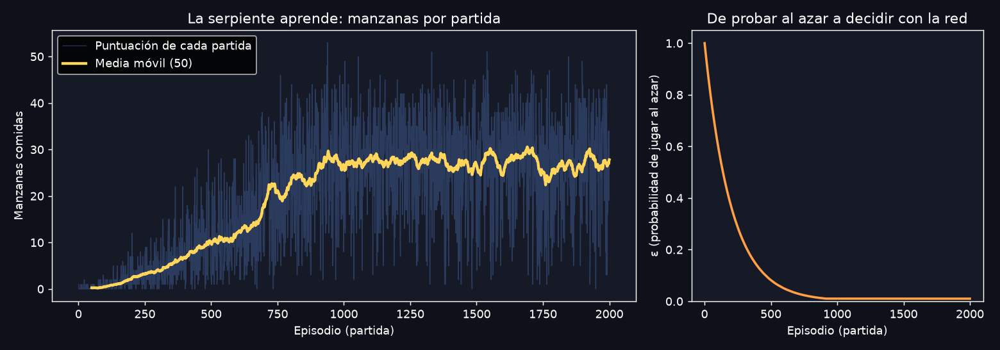
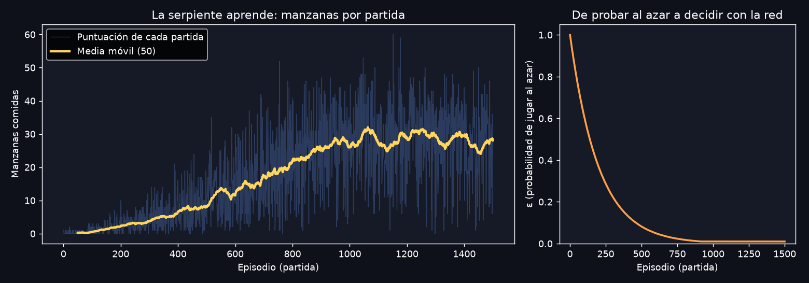
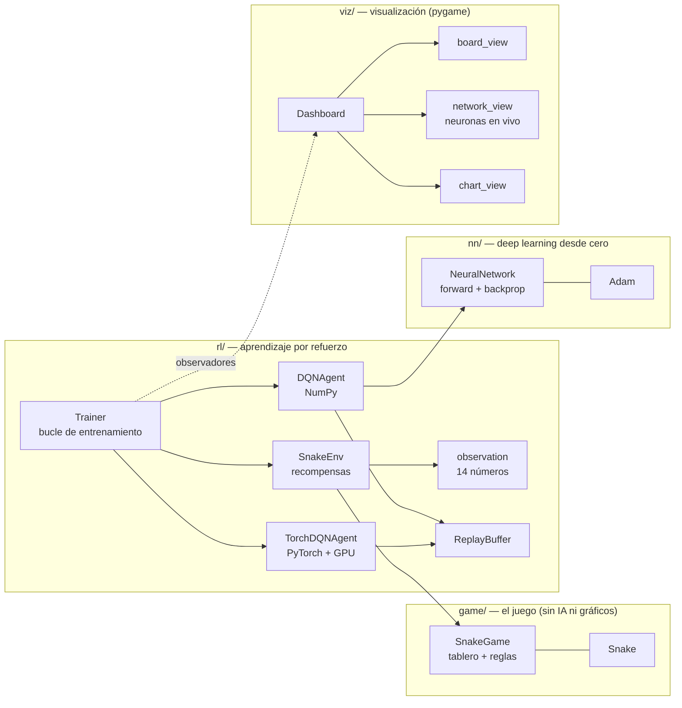
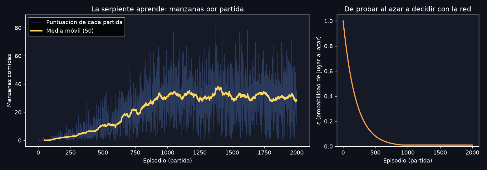
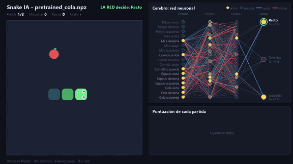

# 🐍 Snake + Deep Learning: una serpiente que aprende sola

Una red neuronal que aprende a jugar al Snake únicamente a base de prueba y error. Hay **dos formas de
entrenarla**: una **escrita desde cero con NumPy** (para entender cómo funciona por dentro) y otra con
**PyTorch**, que puede entrenar en la **GPU** (CUDA). Y el proyecto **va mejorando por etapas**: mira la
[hoja de ruta](#-hoja-de-ruta-cómo-ha-ido-mejorando-la-serpiente). Nadie le explica las reglas ni le enseña a jugar: solo recibe
puntos cuando se come una manzana y pierde puntos cuando se estrella.

Lo mejor: **puedes ver su "cerebro" funcionando**, neurona a neurona, mientras aprende y mientras juega.



> **Qué se ve en el GIF:** a la izquierda, el juego. A la derecha arriba, la red neuronal: las neuronas
> amarillas están activas, las apagadas están desactivadas, y las líneas azules/rojas muestran qué
> conexiones están empujando la decisión. Abajo, la gráfica de puntuación.

---

## Índice

1. [Inicio rápido](#-inicio-rápido)
2. [¿Cómo aprende? Explicado paso a paso](#-cómo-aprende-explicado-paso-a-paso)
3. [Cómo leer la visualización del cerebro](#-cómo-leer-la-visualización-del-cerebro)
4. [Resultados](#-resultados)
5. [Versión PyTorch y GPU (CUDA)](#-versión-pytorch-y-gpu-cuda)
6. [Arquitectura del proyecto](#-arquitectura-del-proyecto)
7. [Todos los comandos](#-todos-los-comandos)
8. [Experimentos que puedes probar](#-experimentos-que-puedes-probar)
9. [Hoja de ruta: cómo ha ido mejorando](#-hoja-de-ruta-cómo-ha-ido-mejorando-la-serpiente)
10. [Glosario](#-glosario)
11. [Tests y licencia](#-tests)

---

## 🚀 Inicio rápido

Necesitas Python 3.10 o superior.

```bash
# 1. Instalar dependencias (mejor dentro de un entorno virtual: python -m venv .venv)
pip install -r requirements.txt

# 2. Ver jugar a la IA ya entrenada (incluida en el repositorio)
python main.py watch

# 3. Ver cómo APRENDE desde cero, con el cerebro visible (tarda unos 2-3 minutos)
python main.py train --render

# 4. Jugar tú mismo (flechas o WASD)
python main.py play
```

Controles de la ventana de visualización: `↑`/`↓` cambian la velocidad (Lento → Turbo),
`Espacio` pausa y `Esc` sale.

> **¿Quieres PyTorch/GPU?** Es opcional: todo lo anterior funciona sin él. Mira
> [Versión PyTorch y GPU](#-versión-pytorch-y-gpu-cuda). Y si quieres guardar un GIF de lo que ves, añade
> `--record salida.gif` a `train` o `watch`.

### Los modelos incluidos

El repositorio trae **tres redes ya entrenadas**, en el mismo formato (`.npz`). Cada una guarda dentro qué
"pistas" recibe, así que todas se ven con el mismo comando:

| Modelo | Cómo se entrenó | Archivo | Comando para verlo |
|---|---|---|---|
| **NumPy** (pistas `basico`, 14) | Red hecha a mano, en CPU, 2000 partidas | `models/pretrained.npz` | `python main.py watch` |
| **PyTorch + GPU** (pistas `basico`, 14) | PyTorch en una RTX 3060 (CUDA), 1500 partidas | `models/pretrained_gpu.npz` | `python main.py watch --model models/pretrained_gpu.npz` |
| **Con la cola** (pistas `cola`, 17) ⭐ el mejor | NumPy, CPU, 2000 partidas | `models/pretrained_cola.npz` | `python main.py watch --model models/pretrained_cola.npz` |

Para compararlos de forma justa, que jueguen con las mismas manzanas usando la misma semilla:

```bash
python main.py watch --model models/pretrained.npz     --seed 1
python main.py watch --model models/pretrained_gpu.npz --seed 1
```

Resultados de ambos en [Resultados](#-resultados).

### Ver cómo evoluciona el aprendizaje

El repositorio incluye "fotos" de la red NumPy en distintos momentos del entrenamiento. Compáralas:

```bash
python main.py watch --model models/evolution/ep_00100.npz   # tras 100 partidas
python main.py watch --model models/evolution/ep_00500.npz   # tras 500 partidas
python main.py watch --model models/evolution/ep_02000.npz   # tras 2000 partidas
```

Manzanas de media de cada "foto" jugando **sin azar** (100 partidas en 10×10):

| Red sin entrenar | Tras 100 partidas | Tras 500 | Tras 1000 | Tras 2000 |
|---:|---:|---:|---:|---:|
| 0,1 | 14,0 | 33,8 | 36,5 | 37,8 |

La red aprende **muy rápido**: con solo 100 partidas ya come bastantes manzanas, y a las 500 está casi en su
nivel final. La curva de entrenamiento de más abajo parece ir más despacio porque, durante el entrenamiento, la
serpiente juega **al azar a propósito** (ε) al principio para explorar. Esa curva mide lo que *hace* mientras
entrena, no lo que la red *ya sabe*.

| Tras 100 partidas (media 14) | Modelo final `pretrained.npz` (media 36,5) |
|:---:|:---:|
|  |  |

---

## 🧠 Cómo aprende: explicado paso a paso

No hace falta saber matemáticas. La idea completa cabe en cinco pasos.

### Paso 1 · La serpiente no "ve" la pantalla

La red recibe solo **14 números** con las pistas que necesita:

| Nº | Entrada | Significa |
|---|---|---|
| 1 | Peligro recto | ¿Si sigo recto, me mato? |
| 2 | Peligro derecha | ¿Si giro a la derecha, me mato? |
| 3 | Peligro izquierda | ¿Si giro a la izquierda, me mato? |
| 4–7 | Mira arriba/derecha/abajo/izquierda | Hacia dónde mira ahora (solo una vale 1) |
| 8–11 | Comida arriba/derecha/abajo/izquierda | Dónde está la manzana respecto a la cabeza |
| 12–14 | Espacio recto/derecha/izquierda | **Cuánto espacio libre alcanzable** quedaría tras ese movimiento (de 0 a 1) |

> Este es el juego de pistas `basico`. El modelo con la cola usa 3 más (ver
> [Modelo 2](#modelo-2--la-serpiente-que-sabe-dónde-está-su-cola)): se elige con `train --features cola`.

Las 11 primeras valen 0 o 1. Las 3 últimas son las que evitan que la serpiente **se encierre a sí misma**:
miden con una búsqueda por inundación (*flood fill*) cuántas casillas libres se pueden alcanzar tras cada
movimiento, comparado con lo larga que es la serpiente. Un valor bajo significa "esto es un callejón sin
salida". Sin ellas, la serpiente solo veía peligros a **una** casilla y se metía en trampas (ver
[Resultados](#-resultados)).

### Paso 2 · La red decide entre 3 acciones

Las salidas son: **seguir recto**, **girar a la derecha** o **girar a la izquierda**. Para cada una,
la red calcula un número llamado **valor Q**: "cuántos puntos creo que conseguiré en total si hago esto
ahora". Juega la acción con el Q más alto.

### Paso 3 · Dentro de la red neuronal

```
 14 entradas ──► 24 neuronas ──► 24 neuronas ──► 3 salidas (valores Q)
                  (oculta 1)      (oculta 2)
```

Cada neurona hace algo muy simple:

1. Multiplica cada entrada por un **peso** (la importancia que le da a esa entrada) y lo suma todo.
2. Pasa el resultado por **ReLU**: si es negativo, la neurona se **apaga** (devuelve 0); si es positivo, se
   **activa** con esa fuerza.

Los pesos son lo que la red "sabe". Al principio son aleatorios (la serpiente se mueve sin sentido); aprender
significa ajustar los **1035 pesos** hasta que las decisiones sean buenas.

### Paso 4 · Recompensas: cómo sabe si lo hace bien

| Evento | Recompensa |
|---|---|
| Comerse una manzana | **+10** |
| Estrellarse o morir de hambre | **−10** |
| Acercarse a la manzana | +0,1 |
| Alejarse de la manzana | −0,1 |

Las dos últimas son una pequeña "pista" para que descubra más rápido que las manzanas son buenas.

### Paso 5 · El bucle de aprendizaje (DQN)

Repite miles de veces:

```
   ┌─► 1. Mira la situación (14 números)
   │   2. Elige acción: con probabilidad ε al AZAR, si no, la que diga la red
   │   3. Juega la acción y recibe una recompensa
   │   4. Guarda la experiencia en una "memoria"
   │   5. Saca experiencias ALEATORIAS de la memoria y ajusta los pesos para que
   └───    Q(situación, acción) se parezca a  recompensa + 0,95 × (mejor Q de la situación siguiente)
```

Los ingredientes y por qué importan:

| Ingrediente | Qué hace | Dónde está el código |
|---|---|---|
| **ε-greedy** (exploración) | Al principio juega al azar (ε = 1) para descubrir cosas; poco a poco confía más en la red (ε → 0,01). | [`rl/dqn_agent.py`](snake_ai/rl/dqn_agent.py) |
| **Experience replay** | Entrena con experiencias mezcladas de la memoria, no solo con lo último que vivió. Aprende de forma más estable. | [`rl/replay_buffer.py`](snake_ai/rl/replay_buffer.py) |
| **Red objetivo** | Una copia "congelada" de la red que se actualiza cada 500 pasos y da objetivos estables (si no, el objetivo se mueve mientras lo persigues). | [`rl/dqn_agent.py`](snake_ai/rl/dqn_agent.py) |
| **Double DQN** | Una red elige la mejor acción futura y la otra la evalúa: evita ser demasiado optimista. | [`rl/dqn_agent.py`](snake_ai/rl/dqn_agent.py) |
| **Retropropagación** | Calcula cuánto contribuyó cada peso al error y en qué dirección moverlo. | [`nn/network.py`](snake_ai/nn/network.py) |
| **Adam** | Mueve los pesos con pasos inteligentes (con inercia y tamaño adaptativo). | [`nn/optimizers.py`](snake_ai/nn/optimizers.py) |

Toda la red está en **~115 líneas de NumPy** ([`nn/network.py`](snake_ai/nn/network.py)) y su retropropagación
está verificada en los tests comparándola con el gradiente calculado "a fuerza bruta".

---

## 👁 Cómo leer la visualización del cerebro

| Elemento | Significado |
|---|---|
| 🟡 Neurona amarilla | **Activa**. Cuanto más brillante, más fuerte. |
| ⚫ Neurona oscura | **Desactivada** (la ReLU dio 0). No aporta nada en este instante. |
| 🔵 Línea azul | Conexión que **excita** a la neurona siguiente (la empuja a activarse). |
| 🔴 Línea roja | Conexión que la **inhibe** (la empuja a apagarse). |
| Grosor de la línea | Cuánto aporta ahora mismo: *activación de origen × peso*. Si la neurona de origen está apagada, su línea desaparece. |
| ⭕ Aro verde en la salida | La red **ha decidido** esa acción. |
| ⭕ Aro naranja en la salida | La acción se eligió **al azar** (exploración durante el entrenamiento). |
| `Q=+3.51` | Valor Q de cada acción: lo buena que cree la red que es. |

**Qué observar:**

- Con la **red sin entrenar** (primeros episodios), las activaciones son caóticas y no tienen relación con la
  situación: la serpiente va dando tumbos.
- Con la **red entrenada**, ves patrones claros. Medido en la red incluida, con la serpiente mirando a la
  derecha y la manzana también a la derecha:

  | Situación | Q Recto | Q Derecha | Q Izquierda | Decide |
  |---|---|---|---|---|
  | Camino libre | **+10,48** | +7,17 | +7,71 | Recto |
  | Pared justo delante | **−7,66** | +6,52 | +6,89 | Girar a la izquierda |
  | Manzana abajo (a su derecha) | +9,35 | **+11,31** | +6,83 | Girar a la derecha |
  | Manzana delante, pero seguir recto lleva a un callejón | **−1,00** | +5,67 | +6,10 | Girar a la izquierda |

  Cuando se enciende "Peligro recto", el valor Q de seguir recto se desploma. Y fíjate en la última fila: aunque
  la manzana esté justo delante (con camino libre, Q recto = +10,48), si las entradas de espacio avisan de
  que ahí hay una trampa, la red **renuncia a la manzana**. Nadie le programó esas reglas: las ha
  descubierto sola.
- Durante el entrenamiento puedes ver cómo **cambian los pesos** (el color y grosor de las líneas) y cómo
  el aro naranja (azar) va dejando paso al verde (decisión de la red).

---

## 📈 Resultados

### Cómo aprendieron

**Modelo NumPy**: 2000 partidas en un tablero de 10×10 (≈ 2 minutos en un portátil, solo CPU). Recuerda: la
curva incluye las jugadas al azar del principio, por eso sube más despacio que lo que la red ya sabe.



**Modelo PyTorch + GPU**: 1500 partidas, mismos parámetros y semilla (`train --backend torch --device cuda --seed 7`).



### Cuánto juegan

Medido en 300 partidas sin azar, con una semilla que no se usó para elegir el modelo:

| Jugador | Manzanas de media (10×10) | Récord visto |
|---|---:|---:|
| Jugando al azar | 0,2 | – |
| Red con 11 entradas (versión anterior, solo peligros cercanos) | 20,1 | 37 |
| **Red con 14 entradas (con espacio libre), modelo NumPy** | **36,5** | **55** |
| **Red con 14 entradas (con espacio libre), modelo PyTorch + GPU** | **38,5** | **63** |
| **Red con 17 entradas (espacio libre dinámico + cola), modelo NumPy** ⭐ | **57,8** | **90** |

Los dos modelos de 14 entradas rinden prácticamente igual: la diferencia de 2 manzanas está dentro del ruido
entre entrenamientos (cada uno tuvo distinto número de partidas y el azar influye), así que **no significa que
PyTorch o la GPU aprendan mejor**: es el mismo algoritmo, solo que calculado en otro sitio.

Añadir las 3 entradas de espacio libre casi **duplica** la puntuación (+82 %). Aun así, casi todas las
partidas siguen terminando por chocar con el propio cuerpo; la diferencia es que ahora la serpiente está
mucho más larga cuando ocurre (con 100 casillas y ~36 de largo, cada giro es muy ajustado).

**Lo curioso: funciona en tableros que nunca vio.** Como la red solo recibe pistas *relativas* a la cabeza
(peligro, dirección, comida, espacio), no sabe nada del tamaño del tablero. La misma red (modelo NumPy), entrenada
en 10×10, consigue (100 partidas por tablero):

| Tablero | Manzanas de media |
|---|---:|
| 6×6 | 17,7 |
| 10×10 (el de entrenamiento) | 36,5 |
| 15×15 | 58,9 |
| 20×20 | 74,6 |

```bash
python main.py watch --width 20 --height 20
```

> Los números exactos varían un poco entre ejecuciones (hay azar en dónde aparece la manzana).
> Puedes reproducir un entrenamiento concreto con `--seed`.

---

## ⚡ Versión PyTorch y GPU (CUDA)

El proyecto tiene **dos backends** que hacen exactamente lo mismo (mismo algoritmo, mismas recompensas, misma
visualización). Eliges con `--backend`:

| | `--backend numpy` (por defecto) | `--backend torch` |
|---|---|---|
| Red y retropropagación | Escritas a mano (se leen en [`nn/network.py`](snake_ai/nn/network.py)) | PyTorch `autograd` ([`rl/torch_agent.py`](snake_ai/rl/torch_agent.py)) |
| Hardware | CPU | CPU o **GPU NVIDIA (CUDA)** |
| Para qué sirve | **Aprender** cómo funciona por dentro | Redes grandes, escalar, usar el ecosistema PyTorch |

Los modelos se guardan en el mismo formato `.npz`: **una red entrenada en la GPU se puede ver con
`python main.py watch`, y al revés**.

### Instalación con GPU

En Windows, `pip install torch` a secas instala la versión **solo CPU**. Para usar tu tarjeta NVIDIA:

```bash
pip install torch --index-url https://download.pytorch.org/whl/cu128
python -c "import torch; print(torch.cuda.is_available())"   # debe imprimir True
```

### Entrenar en la GPU

```bash
python main.py train --backend torch --device cuda --render     # fuerza la GPU (error claro si no hay)
python main.py train --backend torch                            # --device auto: GPU si existe, si no CPU
```

### ¿Es más rápida la GPU? Depende del tamaño de la red

Medido con `python scripts/benchmark_backends.py` en un portátil con RTX 3060, repetido 3 veces (pasos de
aprendizaje por segundo, más es mejor; se indica el rango entre ejecuciones):

| Red neuronal | NumPy (CPU) | PyTorch (CPU) | PyTorch (GPU) |
|---|---:|---:|---:|
| Pequeña: `24, 24` (la del proyecto, 1035 parámetros), lote 64 | **2920–3199** | 663–693 | 443–536 |
| Mediana: `256, 256`, lote 256 | 324–457 | 361–392 | 443–516 |
| Grande: `1024, 1024, 1024`, lote 1024 | 9–10 | 16–17 | **52–270** |

**Para la red pequeña del proyecto, la GPU NO es más rápida; de hecho NumPy en CPU gana.** Es normal:
una red tan diminuta se calcula en microsegundos, y lo que cuesta es *lanzar* cada operación en la GPU y
mover datos entre la CPU y la GPU. La GPU compensa cuando hay mucho cálculo por paso, como en la red grande
(entre 5 y 27 veces más rápida que NumPy según la ejecución). Para notarlo:

```bash
python main.py train --backend torch --device cuda --hidden 1024 1024 1024 --batch-size 1024
```

> Ojo: esa red enorme es mucho más grande de lo que necesita un problema con solo 14 entradas, así que
> no esperes que juegue mejor, solo que entrene más rápido que en CPU. La GPU brilla más si se amplía el
> proyecto (por ejemplo, una red convolucional que vea el tablero como imagen).

---

## 🏗 Arquitectura del proyecto

El diseño separa **tres cosas independientes**: el juego, el aprendizaje y la visualización. El juego no
sabe que existe una IA, y el entrenamiento no sabe que existen los gráficos.



```
snake-deep-learning/
├── main.py                  # Punto de entrada: python main.py {play,train,watch,plot}
├── requirements.txt         # Dependencias base (NumPy, pygame, matplotlib, Pillow)
├── requirements-torch.txt   # Opcional: PyTorch + instrucciones para CUDA
├── requirements-dev.txt     # Opcional: pytest, para ejecutar los tests
├── LICENSE                  # MIT
├── snake_ai/
│   ├── cli.py               # Comandos y opciones
│   ├── human.py             # Modo "juega tú"
│   ├── watch.py             # Ver jugar a una red entrenada
│   ├── game/                # EL JUEGO (reglas puras, sin dependencias)
│   │   ├── actions.py       #   Direcciones y acciones (recto / derecha / izquierda)
│   │   ├── snake.py         #   La serpiente
│   │   └── board.py         #   Tablero, comida, colisiones, victoria
│   ├── nn/                  # DEEP LEARNING DESDE CERO
│   │   ├── network.py       #   Red neuronal: forward, backward, guardar/cargar
│   │   └── optimizers.py    #   Adam
│   ├── rl/                  # APRENDIZAJE POR REFUERZO
│   │   ├── observation.py   #   Qué "ve" la red (juegos de pistas: basico = 14, cola = 17)
│   │   ├── environment.py   #   Entorno + recompensas
│   │   ├── replay_buffer.py #   Memoria de experiencias
│   │   ├── dqn_agent.py     #   El agente DQN con NumPy (ε-greedy, red objetivo, Double DQN)
│   │   ├── torch_agent.py   #   El mismo agente con PyTorch (CPU/GPU CUDA)
│   │   └── trainer.py       #   Bucle de entrenamiento + historial + observadores
│   └── viz/                 # VISUALIZACIÓN
│       ├── dashboard.py     #   Ventana principal y controles
│       ├── network_view.py  #   El cerebro con neuronas activándose
│       ├── board_view.py    #   Tablero y serpiente
│       ├── chart_view.py    #   Gráfica en vivo
│       ├── recorder.py      #   Grabar GIFs
│       └── plots.py         #   Gráfica final (matplotlib)
├── scripts/
│   └── benchmark_backends.py  # Compara NumPy vs PyTorch CPU vs GPU
├── tests/                   # 30 tests (reglas, gradientes, entrenamiento, NumPy≡PyTorch)
├── models/
│   ├── pretrained.npz       # Red ya entrenada con NumPy (CPU)
│   ├── pretrained_gpu.npz   # Red ya entrenada con PyTorch en GPU (CUDA)
│   ├── pretrained_cola.npz  # Red con pistas de la cola (la mejor)
│   ├── evolution/           # La red NumPy tras 100, 500, 1000 y 2000 partidas
│   ├── history.csv          # Datos del entrenamiento NumPy
│   ├── history_gpu.csv      # Datos del entrenamiento PyTorch/GPU
│   └── history_cola.csv     # Datos del entrenamiento del modelo con la cola
└── docs/img/                # GIFs y gráficas del README
```

**Decisiones de diseño**

- **NumPy por defecto, PyTorch opcional.** Para divulgar, cada paso (propagación, retropropagación,
  optimizador) está a la vista en la versión NumPy, sin cajas negras, y se instala con un solo `pip`.
  La versión PyTorch es un segundo *agente* con la misma interfaz: el `Trainer` y la visualización no saben
  cuál de los dos usan, y `torch` solo se importa si lo pides.
- **Acciones relativas** (recto/derecha/izquierda) en vez de absolutas (4 direcciones): la red tiene
  3 salidas y no puede elegir darse la vuelta de 180°, que sería suicida.
- **Patrón observador en el entrenador.** `Trainer` avisa en cada decisión y al terminar cada partida; la
  ventana gráfica y el log por consola son solo observadores enchufados. Se puede entrenar sin pygame
  (más rápido) o añadir nuevos observadores sin tocar el entrenamiento.
- **Observaciones relativas a la cabeza**, lo que permite que la red se generalice a tableros de otro tamaño.

---

## ⌨ Todos los comandos

```bash
python main.py play  [--width 10 --height 10]

python main.py train [--episodes 1500] [--hidden 24 24] [--lr 0.001] [--gamma 0.95] [--batch-size 64]
                     [--backend numpy|torch] [--device auto|cpu|cuda]
                     [--features basico|cola]
                     [--width 10 --height 10] [--seed 42] [--out models]
                     [--render] [--speed Lento|Normal|Rápido|Turbo] [--record salida.gif]

python main.py watch [--model models/pretrained.npz] [--games 20] [--speed Normal]
                     [--width 20 --height 20] [--seed 1] [--record salida.gif]

python main.py plot  [--history models/history.csv] [--out docs/img/training.png]
```

El entrenamiento guarda en `--out`: `best.npz` (mejor media móvil), `last.npz`, `snapshots/` (una foto cada
100 partidas) e `history.csv`. Esos resultados propios **no se suben a Git** (`.gitignore` solo conserva los
modelos preentrenados incluidos), así que puedes entrenar con tranquilidad sin ensuciar el repositorio.

Entrenar **sin** ventana es más rápido; con `--render --speed Turbo` casi no se nota la diferencia
(solo se dibuja ~30 veces por segundo).

---

## 🔬 Experimentos que puedes probar

| Prueba | La pregunta que responde |
|---|---|
| `train --hidden 4` | ¿Cuántas neuronas hacen falta como mínimo? Míralo en la visualización: con menos neuronas, ¿se ven las mismas "rutas"? |
| `train --hidden 64 64` | ¿Más neuronas es siempre mejor? Compara la velocidad de aprendizaje. |
| `train --gamma 0` | La serpiente solo piensa en la recompensa inmediata, sin futuro. ¿Qué cambia? |
| `train --episodes 200` | ¿Cuánto tiempo necesita el aprendizaje antes de despegar? |
| `watch --width 30 --height 30` | ¿Sigue funcionando en un tablero enorme? |
| Cambiar `RewardConfig` en [`environment.py`](snake_ai/rl/environment.py) | Quita el +0,1/−0,1 de "acercarse": ¿aprende igual de rápido? | 

Usa `--seed` para que dos entrenamientos sean comparables.

---

## 🧭 Hoja de ruta: cómo ha ido mejorando la serpiente

El proyecto avanza por etapas: cada una resuelve una limitación de la anterior y deja su modelo en el
repositorio para poder compararlos. Esta tabla es el registro de esa evolución:

| Etapa | Qué se mejoró | Manzanas de media (10×10) | Estado |
|---|---|---:|---|
| **Modelo 0** | Red con 11 pistas (solo peligros cercanos). Se encerraba a sí misma. | 20,1 | ✅ (versión inicial) |
| **Modelo 1** | + 3 pistas de espacio libre (flood fill). NumPy y PyTorch/GPU. | 36,5 (NumPy) · 38,5 (GPU) | ✅ `pretrained.npz`, `pretrained_gpu.npz` |
| **Modelo 2** | El espacio libre tiene en cuenta cómo **se mueve la cola** + 3 pistas de "¿puedo llegar a mi cola?" | **57,8** | ✅ `pretrained_cola.npz` |
| **Modelo 3** | Red **convolucional** que recibe el tablero entero como imagen | – | ⏳ pendiente |
| **Modelo 4** | Aprovechar la **GPU** de verdad: muchas partidas en paralelo | – | ⏳ pendiente |
| **Modelo 5** | **Algoritmos genéticos** (neuroevolución) en vez de DQN, para comparar | – | ⏳ pendiente |

(Medido sin azar, en 300 partidas con una semilla que no se usó para entrenar. Las etapas ⏳ se irán
completando y esta tabla se actualizará con cada una.)

### Modelo 2 · La serpiente que sabe dónde está su cola

**El problema.** El modelo 1 calculaba el espacio libre suponiendo que el cuerpo está quieto, salvo la cola.
Pero la serpiente se mueve: cada paso libera un trozo de cuerpo. Así que a veces veía "callejón sin salida" donde
en realidad el pasillo se iba a abrir a tiempo, y otras veces no distinguía una salida real de una trampa.

**La solución** (en [`game/board.py`](snake_ai/game/board.py), `escape_info`, y [`rl/observation.py`](snake_ai/rl/observation.py)):

1. **Espacio libre "con el tiempo"**: en la búsqueda por inundación, una casilla ocupada por el trozo de
   cuerpo que está a *k* pasos de la cola cuenta como libre si la cabeza llega allí después del paso *k*.
2. **3 pistas nuevas** (*Cola recto / derecha / izquierda*): tras ese movimiento, ¿existe un camino hasta mi
   propia cola? Si lo hay, siempre habrá por dónde salir (la cola siempre se aparta). Es el truco clásico de
   los buenos jugadores de Snake. La red pasa de 14 a **17 entradas** (1.107 pesos).

**El resultado.** Mismo algoritmo, misma red de 24+24 neuronas, mismas 2000 partidas y misma semilla (1);
solo cambian las pistas (300 partidas sin azar):

| Entrenamiento | Manzanas de media | Récord | Cómo murió |
|---|---:|---:|---|
| Pistas `basico` | 35,7 | 57 | cuerpo 87 %, pared 13 % |
| **Pistas `cola`** (`pretrained_cola.npz`) | **57,8** | **90** | cuerpo 77 %, pared 19 %, hambre 4 % |

Con otra semilla de entrenamiento (2) el resultado se mantiene (`basico` 37,7 · `cola` 55,6), así que **no es
suerte de un entrenamiento**: es un +55 % solo por dar mejores pistas. En ese segundo entrenamiento la serpiente
llegó incluso a **completar el tablero entero** (97 manzanas) en una de las 300 partidas.

```bash
python main.py watch --model models/pretrained_cola.npz                  # verla jugar
python main.py train --features cola --render                            # entrenarla tú, viendo el cerebro
```

| Curva de aprendizaje (con azar) | La red jugando |
|:---:|:---:|
|  |  |

### Limitaciones que quedan

Aún muere sobre todo chocando con su cuerpo cuando ya es muy larga, y no planifica varias jugadas por
adelantado. Eso es lo que atacan las etapas pendientes de la tabla de arriba.

---

## 📖 Glosario

| Término | Explicación corta |
|---|---|
| **Neurona** | Suma sus entradas ponderadas por pesos y decide con qué fuerza se activa. |
| **Peso** | Número que indica la importancia de una conexión. Es lo que se "aprende". |
| **ReLU** | Función de activación: `max(0, x)`. Neurona apagada si es negativa. |
| **Valor Q** | Estimación de la recompensa total futura de hacer una acción en una situación. |
| **Episodio** | Una partida completa, desde que nace la serpiente hasta que muere. |
| **ε (épsilon)** | Probabilidad de actuar al azar para explorar. Baja durante el entrenamiento. |
| **γ (gamma)** | Cuánto se valora el futuro frente al presente (0 = nada, 1 = igual). |
| **Retropropagación** | Algoritmo que calcula cómo ajustar cada peso para reducir el error. |
| **DQN** | *Deep Q-Network*: aprender los valores Q con una red neuronal. |

---

## 🧪 Tests

```bash
pip install -r requirements-dev.txt
python -m pytest        # los tests de PyTorch se saltan solos si no está instalado
```

## 📄 Licencia

MIT. Haz lo que quieras con él: aprende, enseña, modifica y comparte.
